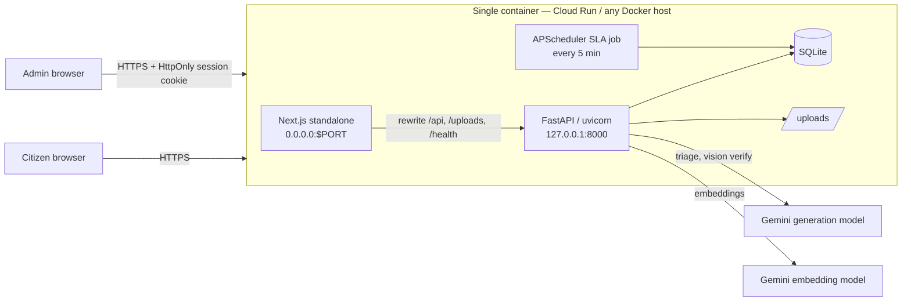

# CivicResolve

> **Problem statement (verbatim)**
>
> Build CivicResolve, an AI-powered civic issue reporting and management platform that simplifies how citizens report local infrastructure and public-service issues.
> Your application should allow citizens to report civic problems through a simple interface. Using AI capabilities powered by Google Gemini, the platform should intelligently understand the reported issue, categorize it, identify its urgency, and recommend the appropriate department for handling it.
> Create a functional prototype that demonstrates how a reported civic issue can move from submission to tracking and resolution.
> The goal is to make civic issue reporting more accessible, organized, and transparent through AI-powered assistance.

## Selected vertical and persona

**Chosen challenge:** CivicResolve — civic infrastructure and local public-service issue reporting. The organisers' exact **vertical label** was not included with this project; match this description to the official allowed vertical before submitting.

**Primary persona — citizen reporting a local problem.** A resident may know that a streetlight is broken or water is leaking, but not which department owns the issue or how urgent it is. They need a quick accessible way to describe it, choose a location, optionally add a photo, and receive a trackable report ID.

**Secondary persona — municipal operations coordinator.** A municipal operator needs a prioritized queue, duplicate corroboration, transparent progress updates, and escalation when response deadlines are exceeded.

### Approach: context-aware assistant and verifiable decision flow

1. **Understand user context:** collect title, description, location, optional category hint, and optional image. Do not require the resident to know the correct department.
2. **Interpret:** Gemini (when available) returns a constrained category, priority P1–P5, risk signals and department recommendation; the API validates model output against known values. A rule-based demo fallback keeps the prototype usable if Gemini is unavailable and **labels the source of the recommendation**.
3. **Reason with civic context:** urgency takes account of public-safety keywords and image context; the AI explanation and recommended department appear to the citizen. These are *recommendations*, not a replacement for professional emergency response or municipal authorization.
4. **Organize:** geo-semantic deduplication checks whether nearby similar reports should become corroborations rather than independent tickets. Corroborations feed operational priority.
5. **Act and track:** create a timestamped report, assign an SLA deadline, expose the tracking timeline, and let authorized staff change status. Overdue items enter the SLA escalation flow.
6. **Verify and correct:** review before/after resolution evidence, flag uncertain AI verification for manual inspection, and provide citizens a reopening window.

**Example of dynamic logic:** a pothole described as minor may receive a different urgency recommendation from one reported near a busy school crossing; a water leak close to electrical infrastructure introduces an additional risk signal. Final output depends on submitted context and the actual AI response (or the documented demo rules).

**Explicit assumptions and scope:** Department names and SLA policies are configured as **Bengaluru demo examples**, not authoritative government dispatch integrations. Latitude/longitude must be supplied; map pins are optional because coordinates can be entered by keyboard. Anonymous citizens receive a tracking ID but there is no verified resident identity. AI can be wrong and a trained officer is accountable for taking action. The mock fallback is deterministic and is **not** a live Gemini result. The demonstration uses SQLite/local uploads that are not durable across cloud container replacements. Avoid submitting personally identifying or sensitive photos; demo public reports and map coordinates may be visible to other visitors. The platform is a reporting prototype, not an emergency-response service.

**Hackathon handoff:** [SUBMISSION_CHECKLIST.md](SUBMISSION_CHECKLIST.md) · [EVALUATION_EVIDENCE.md](EVALUATION_EVIDENCE.md) · [CI_REPAIR_GUIDE.md](CI_REPAIR_GUIDE.md). The provided evaluation rubric describes high/medium/low impact tiers but does not assign an official tier to each individual focus area; the priority order in our evidence document is an internal recommendation, not an official score weight.

**CI repair / judge handoff:** [CI_REPAIR_GUIDE.md](CI_REPAIR_GUIDE.md).

**Public GitHub repository:** `<REPLACE_WITH_HTTPS_GITHUB_LINK>` · **Live demo:** `<LIVE_URL>` · **Admin login:** `<LIVE_URL>/admin/login` with the demo admin key given in the submission notes · `GET <LIVE_URL>/health` shows `"ai_mode": "live"` when a Gemini key is configured; successful calls still require verification.

## Requirement → Feature → Where in code → Test that proves it

Every sentence of the problem statement, mapped. Backend paths are relative to `backend/`, frontend paths to `frontend/`.

| # | Requirement (from the statement) | Feature | Where in code | Test that proves it |
|---|---|---|---|---|
| 1 | *AI-powered civic issue **reporting** platform* | Citizen report API: text, location, optional photo | `routes/reports.py` → `create_report` | `tests/test_reports_api.py::test_create_report_happy_path`; `e2e/happy-path.spec.ts` |
| 2 | *…and **management** platform* | Admin issue-management queue (filters, bulk + single status updates), analytics, heatmap, SLA log | `routes/admin.py`, `app/admin/page.tsx`, `components/admin/*` | `tests/test_report_lifecycle.py::test_admin_queue_filters_and_sla_breach_fields`; `tests/test_security.py::test_bulk_status_updates_existing_ids_and_logs_timeline`; `__tests__/AdminDashboard.test.tsx` |
| 3 | *…simplifies how citizens report **local infrastructure and public-service issues*** | Six categories (pothole, garbage, streetlight, water leakage, road damage, other) mapped to municipal departments | `constants.py` (`Category`, `Department`) | `tests/test_ai_and_routes.py::test_mock_triage_keyword_flags` |
| 4 | *allow citizens to report civic problems through a **simple interface*** | One-page form: optional category, title, description, map pin **or** typed coordinates, optional photo | `app/page.tsx`, `components/LocationPicker.tsx` | `__tests__/ReportFlow.test.tsx` (“submits the report…”); `__tests__/LocationPicker.test.tsx` |
| 5 | *Using AI powered by **Google Gemini**…* | Gemini model + embeddings, env-configurable (`GEMINI_MODEL`, `GEMINI_EMBED_MODEL`), mock fallback if no key | `services/gemini_triage.py`, `services/prompts.py`, `services/mock_ai.py` | `tests/test_ai_and_routes.py::test_model_names_default_and_env_override`, `::test_run_triage_live_falls_back_to_mock_on_error`; `tests/test_security.py::test_health_reports_ai_mode` |
| 6 | *…intelligently **understand** the reported issue* | One multimodal Gemini call (text + photo) returns structured JSON with reasoning and risk flags | `services/gemini_triage.py::run_triage` | `tests/test_ai_and_routes.py::test_run_triage_live_parses_fenced_json_and_validates`, `::test_triage_prompt_formats_without_error` |
| 7 | *…**categorize** it* | `category` validated against the enum; falls back to the citizen's hint | `services/gemini_triage.py::_validate_triage` | `tests/test_ai_and_routes.py::test_run_triage_live_parses_fenced_json_and_validates`; `tests/test_reports_api.py::test_create_report_happy_path` |
| 8 | *…identify its **urgency*** | Urgency 1–5 with written reasoning, clamped; drives the SLA deadline | `services/gemini_triage.py`, `services/sla_engine.py` | `tests/test_ai_and_routes.py::test_mock_triage_keyword_flags`; `tests/test_sla_engine.py::test_sla_minutes_urgency_ordering` |
| 9 | *…**recommend the appropriate department*** | Department + confidence + one-line justification | `services/gemini_triage.py`, `components/report/SubmissionResult.tsx` | `tests/test_ai_and_routes.py::test_run_triage_live_parses_fenced_json_and_validates`; `e2e/happy-path.spec.ts` (asserts “PWD”) |
| 10 | *functional prototype… from **submission**…* | Submit → AI triage → instant result card | `routes/reports.py`, `components/report/SubmissionResult.tsx` | `e2e/happy-path.spec.ts` step 1–2 |
| 11 | *…to **tracking**…* | Public tracking page: status progress, timeline, SLA deadline, corroborations | `routes/reports.py::get_report`, `app/track/[id]/page.tsx`, `components/track/*` | `tests/test_reports_api.py::test_get_report_detail_with_corroborations_and_timelines`; `__tests__/TrackPage.test.tsx`; `e2e/happy-path.spec.ts` step 3 |
| 12 | *…and **resolution*** | Admin status updates, resolve with before/after photo verified by Gemini Vision, 72-hour citizen reopen window | `routes/report_lifecycle.py` | `tests/test_report_lifecycle.py::test_resolve_verified_when_ai_confident`, `::test_resolve_with_before_and_after_images_is_flagged_in_mock_mode`; `tests/test_reports_api.py::test_reopen_report_escalates_urgency_and_sla`; `e2e/happy-path.spec.ts` step 4–5 |
| 13 | *make reporting more **accessible*** | WCAG 2.1 AA: keyboard-only flow, typed-coordinate alternative to the map, error summary, 44 px touch targets ([ACCESSIBILITY.md](ACCESSIBILITY.md)) | `app/layout.tsx`, `components/RouteFocus.tsx`, `app/globals.css` | jest-axe in every page test; `e2e/accessibility.spec.ts` |
| 14 | *…more **organized*** | Geo-semantic dedup merges duplicates (150 m + embedding similarity) as corroborations; SLA engine auto-escalates | `services/geo_dedup.py`, `services/sla_engine.py` | `tests/test_geo_dedup.py::test_find_duplicate_within_radius_and_similarity`; `tests/test_report_lifecycle.py::test_create_report_merges_duplicate`; `tests/test_sla_engine.py::test_run_sla_check_escalates_breached_reports` |
| 15 | *…and **transparent*** | Public timeline, AI reasoning shown to the citizen, public SLA-breach log, resolution confidence | `app/track/[id]/page.tsx`, `routes/admin.py::get_sla_log` | `__tests__/TrackPage.test.tsx`; `tests/test_efficiency.py::test_sla_log_join_matches_per_row_lookup` |
| 16 | *…through **AI-powered assistance*** | AI summary on submit, Gemini Vision fix verification, AI-escalated urgency via corroborations | `services/gemini_triage.py::verify_resolution`, `services/geo_dedup.py::merge_as_corroboration` | `tests/test_ai_and_routes.py::test_verify_resolution_live_and_error`; `tests/test_geo_dedup.py::test_merge_as_corroboration_persists_child_and_tightens_sla` |

## Judge quick tour (≈ 4 minutes)

Open `<LIVE_URL>`. The demo data (Bengaluru) is seeded automatically.

1. **Report a civic issue (≤ 1 min).** On the home page choose **Pothole**, enter a title and description, then click the map or type coordinates and press **Use this location**, and submit.
   *Look for:* the result card showing the **AI-recommended department**, urgency **P1–P5**, the Gemini reasoning and an **SLA deadline**.
2. **Track it (≤ 1 min).** Click **Track My Report**.
   *Look for:* the 5-step status progress, a timestamped timeline entry “Report submitted and triaged by AI”, and the SLA deadline with the responsible department.
3. **Duplicates get organized (≤ 1 min).** Open **Map** and click a marker near **MG Road**, then **View Details**.
   *Look for:* **“Also reported by others”**: nearby reports merged by geo-semantic dedup, with the corroboration count raising priority.
4. **Admin management and resolution (≤ 1 min).** Go to `/admin/login` and enter the demo admin key. In the queue, pick **acknowledged** in a row's **Update…** menu and press **✓**, or select rows and use the bulk bar. Press **⚡ Trigger SLA Check**.
   *Look for:* overdue items marked **“SLA breached · Nh overdue”**, the **SLA Breaches** tab (public transparency log), and the status change appearing on that report's tracking page.
5. **Optional (≤ 1 min).** Open **🗺️ Heatmap** to see hotspots weighted by urgency × corroboration, or use the whole site with only the keyboard (Tab / Enter / arrow keys on the admin tabs).

## Architecture



Everything is served from one origin, so the admin cookie never crosses domains. The backend listens on loopback only.

| Layer | Technology | Key files |
|---|---|---|
| Frontend | Next.js 14 App Router, Tailwind, Leaflet (lazy-loaded) | `frontend/app/*`, `frontend/components/*` |
| API | FastAPI, SQLAlchemy 2.0 typed models, APScheduler | `backend/main.py`, `backend/routes/*`, `backend/database.py` |
| AI | Google Gemini (`GEMINI_MODEL`, default `gemini-3.8-flash`; `GEMINI_EMBED_MODEL`, default `gemini-embedding-2`) | `backend/services/gemini_triage.py` |
| Cross-cutting | Security headers + generic errors; gzip / caching / ETag | `backend/app_security.py`, `backend/app_performance.py` |
| Shared taxonomy | Enums and input bounds | `backend/constants.py`, `frontend/components/report/validation.ts` |

### SLA windows (`backend/services/sla_engine.py`)

| Category | P5 (Critical) | P4 (High) | P3 (Medium) | P2 (Low) | P1 (Cosmetic) |
|---|---|---|---|---|---|
| Water Leakage | 1h | 4h | 24h | 72h | 7d |
| Streetlight | 2h | 8h | 24h | 72h | 7d |
| Pothole | 4h | 24h | 72h | 7d | 14d |
| Garbage | 8h | 24h | 72h | 7d | 14d |
| Road Damage | 8h | 48h | 7d | 14d | 30d |

Breaches escalate Ward Officer → Zonal Commissioner → Municipal Commissioner and are logged publicly.

## Security

Threat model (STRIDE), every control, the file that implements it and the test that proves it: see **[SECURITY.md](SECURITY.md)**. Highlights:
- Admin auth uses opaque HttpOnly session tokens; the app refuses to start without `ADMIN_API_KEY`.
- Hardened uploads: only JPEG/PNG/WebP decoders can run, with an 8 MB cap.
- Rate limiting that can't be bypassed by spoofing `X-Forwarded-For`.
- Strict input bounds, CSP and security headers, and generic 500s.
- Audited dependencies (CI fails on any unreviewed high/critical finding).

## Performance

Measured locally (`backend/tests/test_performance.py` asserts the behaviours; numbers from a 200-report SQLite database and `next build`):

| Optimisation | Where | Measured effect |
|---|---|---|
| GZip responses ≥ 500 B | `backend/app_performance.py` | `GET /api/reports?limit=200`: 157,202 B → 2,948 B on the wire (−98%; seeded rows are repetitive, so real data compresses less) |
| Pagination (`limit`/`offset`, `X-Total-Count`) on every list endpoint | `backend/services/pagination.py`, `routes/*.py` | A 20-item page is 15.7 KB instead of 157 KB for 200 items; the default page size is unchanged, so the UI behaves the same |
| ETag + `Cache-Control: no-cache` on report detail; 10 s public cache on the list | `backend/app_performance.py` | Unchanged report revalidates with **304 and a 0-byte body** (852 B → 0 B) |
| `Cache-Control: immutable, 1 year` on `/uploads` (random filenames) | `backend/app_performance.py::ImmutableStaticFiles` | Photos are never re-downloaded on revisits |
| SQL bounding-box prefilter before exact haversine | `routes/reports.py`, `services/geo_dedup.py::bounding_box` | Radius query over 200 reports: 6.2 ms median (30 runs) |
| DB indexes on filter/sort columns; SQL `GROUP BY` analytics; single-join SLA log | `database.py`, `routes/admin.py` | Analytics output is identical to the old loops (`tests/test_efficiency.py::test_analytics_matches_legacy_implementation`) |
| Leaflet JS **and CSS** loaded only by the map components (`next/dynamic`, `ssr: false`) | `components/LocationPicker.tsx`, `PublicMapView.tsx`, `HeatmapPanel.tsx` | Global CSS 38.1 KB → 27.5 KB (gzip 8.1 → 5.8 KB); Leaflet's 10.6 KB loads only with the map chunk |
| Explicit `width`/`height` on every photo (+ `loading="lazy"` on server photos) | `components/track/*`, `components/report/PhotoField.tsx` | No layout shift when photos load |
| Image optimizer disabled (`images.unoptimized`) | `frontend/next.config.js` | Removes the `/_next/image` endpoint (also a security mitigation) |

## Testing

Testing guide in **[TESTING.md](TESTING.md)**; current evidence/limitations in **[VERIFICATION.md](VERIFICATION.md)**. Summary: 181 backend tests (97.17% local route/service coverage; CI gate 90%), a previously reported 60 Jest tests (frontend not rerun for v5; CI gate 80%), and 5 Playwright E2E scenarios requiring a GitHub CI run. Outputs are in **[VERIFICATION.md](VERIFICATION.md)**.

```bash
make lint typecheck test   # same gates as CI
make e2e                   # Playwright against the production build
make audit                 # pip-audit + npm audit with reviewed exceptions
```

## Accessibility

WCAG 2.1 AA checklist and how each item was tested: **[ACCESSIBILITY.md](ACCESSIBILITY.md)**.

## Run locally

Prerequisites: Python 3.11+, Node 20+, and optionally a Gemini API key ([aistudio.google.com](https://aistudio.google.com)). Without a key the app runs in **mock AI** mode.

```bash
cp backend/.env.example backend/.env    # set ADMIN_API_KEY (≥16 chars) and optionally GEMINI_API_KEY
make install
(cd backend && uvicorn main:app --port 8000) &   # API on :8000
(cd frontend && npm run dev)                     # web on http://localhost:3000
```

On Windows, `start.ps1` / `start.bat` do the same. Environment variables:

```ini
ADMIN_API_KEY=<python -c "import secrets; print(secrets.token_urlsafe(32))">   # required
GEMINI_API_KEY=...                       # optional; absent = mock AI
GEMINI_MODEL=gemini-3.8-flash            # optional override
GEMINI_EMBED_MODEL=gemini-embedding-2    # optional override
ENV=development                          # 'production' disables /docs, /redoc, /openapi.json
TRUST_PROXY=0                            # 1 only behind the Cloud Run → Next proxy chain (set in Dockerfile)
DATABASE_URL=sqlite:///./civicresolve.db
UPLOAD_DIR=./uploads
```

The database and demo data are created on first start (`backend/seed_data.py`, `backend/seed_fixtures.py`).

## Deploy (single container)

```bash
gcloud run deploy civicresolve --source . --region asia-south1 --allow-unauthenticated --max-instances 1 \
  --set-secrets ADMIN_API_KEY=civicresolve-admin-key:latest,GEMINI_API_KEY=gemini-api-key:latest
```

The root `Dockerfile` builds the Next.js standalone bundle. `start.sh` then runs FastAPI (loopback) and Next (`$PORT`) as a non-root user and exits if either process dies, so the platform restarts the container. The same image runs on Render, Railway or any Docker host. SQLite and uploads live on the container disk and reset when the instance is replaced, which is fine for a demo.

## Project layout

```
civicresolve/
├── Dockerfile, start.sh, Makefile        # one-container build, process supervisor, dev commands
├── SECURITY.md, TESTING.md, ACCESSIBILITY.md, VERIFICATION.md, CHANGELOG.md
├── security/                             # audit runners + reviewed advisory exceptions
├── .github/workflows/test.yml            # CI: lint, types, tests+coverage, audits, E2E, docker
├── backend/
│   ├── main.py                           # app wiring: lifespan, routers, middleware
│   ├── app_security.py, app_performance.py
│   ├── constants.py, database.py         # enums/bounds; typed SQLAlchemy models + indexes
│   ├── seed_data.py, seed_fixtures.py    # demo data
│   ├── routes/  reports.py, report_lifecycle.py, admin.py, admin_auth.py
│   ├── services/ gemini_triage.py, prompts.py, mock_ai.py, geo_dedup.py, sla_engine.py,
│   │            auth.py, uploads.py, pagination.py
│   └── tests/                            # 181 pytest tests
└── frontend/
    ├── app/                              # report form, track, map, admin (+ login, heatmap)
    ├── components/                       # admin/, track/, report/, heatmap/, maps, RouteFocus
    ├── lib/                              # auth fetch helpers, escapeHtml
    ├── __tests__/, __mocks__/leaflet.ts  # Jest + jest-axe
    └── e2e/                              # Playwright: happy path, keyboard-only, touch targets
```
